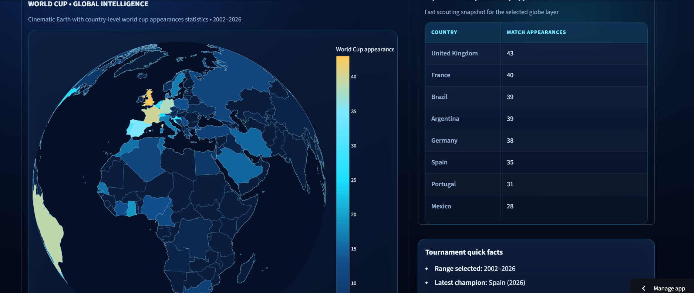
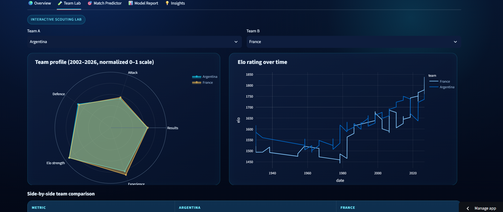
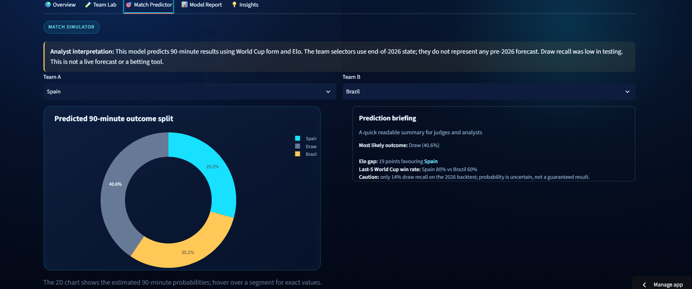
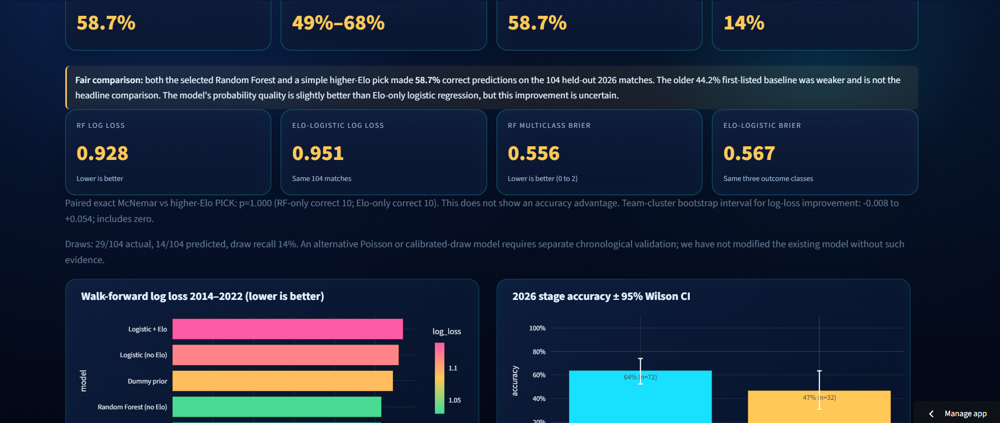
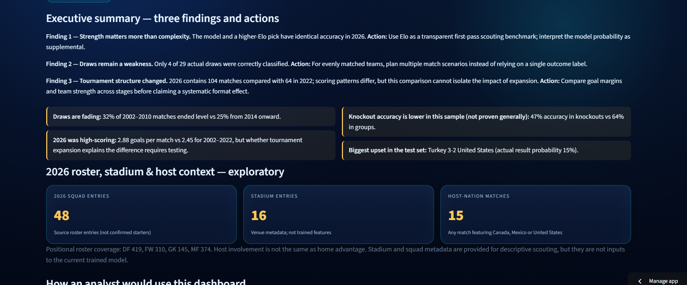

# ⚽ FIFA World Cup Intelligence

**Interactive historical scouting, team comparisons and transparent match-outcome analysis**  
**AQX Sports Analytics Data Bowl 4.0 · Streamlit + Plotly + Three.js**

FIFA World Cup Intelligence is a working Streamlit sports-analytics prototype covering the **men's FIFA World Cups from 1930 to 2026**. It helps users compare national teams, explore tournament evolution and test how much a machine-learning model adds beyond a simple historical Elo baseline.

**The goal:** make World Cup scouting and match analysis visual, explainable and honest about uncertainty—not claim to predict matches with certainty. This independent student project is not affiliated with FIFA.

> **Hackathon judges:** For a concise problem → solution → features → actionable impact summary, read **[PROJECT_DESCRIPTION.md](PROJECT_DESCRIPTION.md)**. The dashboard can be run immediately using the bundled processed data and trained model; a video is not required by the competition.

## Why this matters — 3 takeaways for analysts

1. **Start with a transparent benchmark.** In the 2026 retrospective test, the trained Random Forest and a simple higher-Elo pick both reached **61/104 = 58.7% accuracy**. Use Elo for first-pass scouting instead of assuming a more complex model is automatically better.
2. **Prepare for draw uncertainty.** The model recognized only **4 of 29 actual 90-minute draws (13.8% recall)**. For evenly matched teams, compare multiple possibilities instead of trusting one categorical prediction.
3. **Context matters when formats change.** The 2026 tournament had **104 matches versus 64 in 2022**. Use per-match rates and stage context to interpret scoring patterns; differences alone do not demonstrate the causal effects of expansion.

The dashboard translates these into structured scouting workflows and cautions against overstated sports predictions. Its impact is **decision support and analytical transparency**, not a proven improvement in match outcomes.

## Explore the five interactive sections

| Dashboard tab | What you can investigate | Visuals / outputs |
|---|---|---|
| 🌍 **Overview** | Global World Cup history, champions and scoring patterns | Cinematic/Plotly globe, summary KPIs, goals and outcome charts |
| 🧪 **Team Lab** | How two countries compare in historical form and relative strength | Normalized radar, Elo history, attack/defence, illustrative historical Starting XI |
| 🎯 **Match Predictor** | Retrospective-context 90-minute win/draw/loss probabilities | Probability split, model briefing, optional transparent knockout what-if assumption |
| 📊 **Model Report** | Whether the model outperforms simple alternatives and where it fails | Fair Elo baselines, log loss/Brier, calibration, held-out feature importance, error analysis, intervals |
| 💡 **Insights** | What an analyst can do with the findings | Three findings/actions, upsets, clusters, defensive trends and method caveats |

Suggested judge walkthrough: Open **Overview** → select two countries in **Team Lab** → compare probabilities in **Match Predictor** → inspect **Model Report** → read the action recommendations in **Insights**.

## Quick start 

Requires Python 3.11 or newer. The repository includes the data, reports and a pretrained model, so no training is needed.

```Windows (PowerShell):
py -m venv .venv
.\.venv\Scripts\Activate.ps1
python -m pip install --upgrade pip
python -m pip install -r requirements.txt
python -m streamlit run app.py

macOS / Linux:
python3 -m venv .venv
source .venv/bin/activate
python -m pip install -r requirements.txt
python -m streamlit run app.py
```

Open the local URL displayed by Streamlit (usually `http://localhost:8501`). If PowerShell execution policy prevents activation, run `.\.venv\Scripts\python.exe -m pip install -r requirements.txt` and then `.\.venv\Scripts\python.exe -m streamlit run app.py`.

**Theme:** The project uses a navy/cyan dark palette. Native dropdowns follow `.streamlit/config.toml`, with additional CSS styling in `app.py` for selected and expanded options.

**Browser compatibility:** The cinematic globe and 3D pitch load Three.js through a CDN and need WebGL. Use the included Plotly globe or 2D pitch fallback when unavailable.

## Model evaluation — what the numbers really mean

| 2026 retrospective metric | Result | Interpretation |
|---|---:|---|
| Matches evaluated | 104 | One tournament held out; not many independent tournaments |
| Random Forest accuracy | **58.7% (61/104)** | Equal to selecting the higher-Elo team |
| Higher-Elo rule accuracy | **58.7%** | Fair simple strength benchmark |
| Random Forest multiclass log loss | **0.928** | Smaller is better |
| Elo-only logistic model log loss | **0.951** | Probability-score comparator, fitted separately |
| Draw recall | **13.8% (4/29)** | Major weakness: do not trust single-label draw decisions |

**Evaluation design:** chronological model selection on 2014/2018/2022 validations, training through 2022, retrospective testing on 2026. Probabilities refer to **90-minute** win/draw/loss, not eventual knockout advancement. The slight model log-loss advantage is uncertain: the exploratory team-cluster sensitivity interval crosses zero. This is not a real-time forecast or betting tool. The interactive team selectors use **end-of-2026** context and must never be interpreted as a prediction made before the 2026 tournament.

The report includes held-out 2022 permutation importance, 2022 experience-feature ablation, 2026 error diagnostics and descriptive uncertainty intervals. These do not establish causal feature effects or model superiority across future tournaments.

## Data sources, licensing and credit

- **Included:** [OpenFootball World Cup JSON](https://github.com/openfootball/worldcup.json) (1930–2026), published under **CC0 1.0 / public-domain dedication**. Original notice: [`data/raw/openfootball/LICENSE.md`](data/raw/openfootball/LICENSE.md). Source files, cleaned match tables, aggregate summaries and reports are bundled.
- **Earlier research source, excluded from public release:** [Sourav Banerjee's Kaggle FIFA World Cup dataset](https://www.kaggle.com/datasets/iamsouravbanerjee/fifa-football-world-cup-dataset). The listing does not clearly authorize redistribution, so **Kaggle source CSVs and Kaggle-derived tables are not included**.
- **Map:** locally simplified Natural Earth geographic boundaries (Natural Earth terms: public domain). Three.js is loaded via CDN; its separate MIT terms apply.
- **Authored code:** root [`LICENSE`](LICENSE) is MIT; it does not change rights in third-party datasets, maps, brand names or dependencies.

**Read [`DATA_LICENSE_NOTICE.md`](DATA_LICENSE_NOTICE.md) for full source-by-source provenance and redistribution decisions.** Reconstructed team-year results are derived from observed 90-minute match records, **not official FIFA tournament standings**.

## Reproducing the data and model

The provided data and model are ready to use. To recreate the analytical pipeline after setup:

```powershell
# Optional: run notebooks/01_data_cleaning.ipynb in Jupyter first
python sync_champions.py
python build_lineups.py
python train_model.py
python build_advanced_analytics.py
python build_defensive_trends.py
python audit_model.py
python verify_project.py
```

`audit_model.py` should run **after** model training to keep reports synchronized. The notebooks `02_eda.ipynb` and `04_model_experiments.ipynb` are exploratory; notebook 04 does not overwrite the production model. Notebook 03 documents feature engineering.

**Verification:** `python verify_project.py` checks report consistency, the Plotly API calls and default/fallback Streamlit screens via `AppTest`. For offline static/data checks only, use `python verify_project.py --data-only`; these **do not** validate CSS in a live browser. Dependency versions are pinned in `requirements.txt`, including Streamlit **1.66.1**, and `st.plotly_chart` uses `width='stretch'` consistently.

## Repository overview

```text
app.py                         # Five-tab Streamlit dashboard and UI styling
.streamlit/config.toml         # Native dark-theme defaults for form inputs
PROJECT_DESCRIPTION.md         # Short hackathon submission summary
DATA_LICENSE_NOTICE.md        # Source provenance, licenses and excluded data
notebooks/                     # Cleaning, EDA, feature engineering, experiments
src/                           # Elo, OpenFootball helpers, 3D views
assets/                        # Globe/pitch HTML and map geometry
data/raw/openfootball/         # CC0 original World Cup JSON + license notice
data/processed/                # Reproducible match features, summaries, Elo
data/reports/                  # Evaluations, errors, calibration, insights
models/                        # Trained model + 2026 retrospective backtest
train_model.py / audit_model.py # Model training and evaluation
verify_project.py              # Static/data + optional Streamlit app checks
```

## Known limitations and responsible use

- **No live predictions:** end-of-2026 scouting selections are retrospective. No pre-tournament odds or 2026 pre-match forecasts are represented.
- **90-minute prediction only:** knockout advancement after extra time/penalties is different. The optional advancement slider is a *what-if assumption*, not a learned probability.
- **World Cup-only Elo:** not official FIFA rankings or broader international football Elo. Only past World Cup games update the in-project Elo state.
- **Data gaps:** historical shootout/extra-time metadata and starting-lineup information may be incomplete; pitch placements/formations are illustrative.
- **Statistical uncertainty:** teams appear repeatedly and one 2026 held-out tournament is insufficient to prove future generalization. Some confidence intervals ignore dependencies and are labeled accordingly.
- **Unmodeled drivers:** injuries, current squad/manager decisions, travel, player fitness, home advantage and venue context are not established predictive features in the current model.

For evaluation corrections and methodological caveats, see [`AUDIT_DECISIONS.md`](AUDIT_DECISIONS.md) and [`VERIFICATION_STATUS.md`](VERIFICATION_STATUS.md).

## Dashboard Preview

Explore the five interactive modules of FIFA World Cup Intelligence.

🌍 Overview — World Cup Explorer

Visualize historical tournament statistics, champions, scoring trends, and global football history.


🧪 Team Lab — Comparative Scouting

Compare national teams using Elo ratings, performance metrics, historical trends, and illustrative lineups.


🎯 Match Predictor — Explainable Probabilities

Explore retrospective 90-minute win, draw, and loss probabilities using a Random Forest classifier.


📊 Model Report — Performance Evaluation

Evaluate predictive accuracy, log loss, calibration, and model limitations against transparent Elo baselines.


💡 Insights — From Data to Decisions

Discover historical upsets, scoring patterns, defensive trends, and actionable scouting insights.
